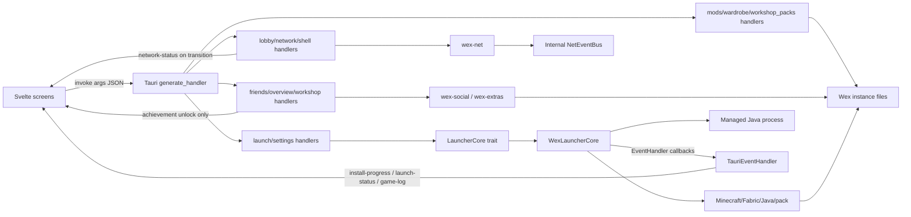

# Architecture and data flow

This describes the implementation at main **afb981a (2026-11-08)**. [IPC.md](IPC.md) is the complete inventory of **101 registered Tauri commands**, their actual argument/result/error shapes, shared contract names that are not registered, and event producers. A generated TypeScript declaration or a UI listener is not evidence that a command or event producer exists.

## Boundaries and workspaces

| Layer | Responsibility | Important implementation boundary |
|---|---|---|
| `ui/` | Svelte 5 screens, theme/network state, components, user actions and event subscriptions | Calls `@tauri-apps/api/core::invoke` and `event::listen`; browser dev lacks the Tauri backend. Screen-specific fallback/empty states do not establish native backend behavior. |
| `app/src-tauri` | Native shell, command registry, state ownership, feature orchestration and event adaptation | Root Cargo workspace. `src/lib.rs::run` registers managed states and all commands. Command handlers contain substantial business logic and app-local DTOs; they are not all thin adapters to one core trait. |
| `core/wex-ipc` | Shared serde request/result/model/event types, `IpcError`, `LauncherCore`, mock and `ts-rs` generation | Contains 60 command constants, only 40 of whose names are registered. App-local handlers and DTOs extend and sometimes differ from this contract. |
| `core/wex-core` | Wex paths/config, downloads/hashes, Minecraft/Fabric/Java/pack preparation and game process management | `WexLauncherCore` in `ipc_adapter.rs` implements `LauncherCore`; owns running processes and cancellation tokens. |
| `core/wex-net` | SLP/DNS ping, NBT server lists, Lobby API, heartbeat, manifest comparison and Playit supervision | Internal `NetEventBus` is distinct from the Tauri event bus. App has no subscriber forwarding it to the UI. |
| `core/wex-social` | Friends service, local achievements, world/backups/screenshots, news and update metadata | Friend state and caches are held by the app; local workshop operations also accept explicit paths. |
| `core/wex-extras` | Crash diagnosis, Discord RPC, explicit old-launcher import, skin/CSL helpers and graphics presets | Used directly by feature handlers and the launch lifecycle. |
| `core/wex-cli` | CLI sync/install/launch using core libraries | Separate entry point; does not use the Tauri command registry. |

`core/Cargo.toml` is the library/CLI workspace. Root `Cargo.toml` is the desktop app workspace. Cargo commands from one workspace do not automatically test the other. Supported game versions remain **1.20.1 / Java 17** and **1.21.1 / Java 21**, with separate instance directories.



There is deliberately no NetEventBus → UI arrow: the app has not wired that bridge. Likewise, event names declared in `wex-ipc` for friend presence, lobby invites and launcher update availability have no `app.emit` producer in this snapshot.

## Startup and managed state

The Rust entry point `app/src-tauri/src/main.rs` calls `wex_app_lib::run`. Tauri setup in `lib.rs`:

1. Creates `WexPaths::new(None)` and attempts `ensure_dirs` (the result is currently ignored).
2. Creates `NetworkState`, starts its background connectivity supervisor, and registers it with Tauri.
3. Creates `PlayState::new_real`: a `WexLauncherCore` with `TauriEventHandler`, flags/current version, paths and a Discord client connection started in the background.
4. Registers `FriendsState`, legacy `AppState`, and `LobbyState` with Lobby API clients, its own session/heartbeat/tunnel storage and a `NetEventBus`.
5. Registers the 101 command functions and starts Tauri's event loop.

There is **no `commands/startup.rs` or registered `startup` command** at this revision. Startup work is the setup closure plus frontend mounts. The UI entry point mounts App; App checks shell network/profile, asks `is_game_running`, starts a 30-second network poll, and subscribes to launch/progress/social events when Tauri is present. PlayScreen loads server/news data, asks `overview_check_update`, and performs first-run old-launcher detection gated by localStorage. An update query without a configured manifest URL reports `update_available=false`; it does not fetch a release manifest.

| Managed state | Ownership / lifetime |
|---|---|
| `PlayState` | `Arc<dyn LauncherCore>`, paths, atomic is_launching/is_running, async mutex running_version, Discord client, shared NetworkState. The core separately owns process handles and cancellation tokens. |
| `NetworkState` | Shared online atomic and optional test override; supervisor runs every five seconds, probes TCP DNS endpoints, and emits only transitions. |
| `FriendsState` | FriendApiClient, optional auth and in-memory friends/requests/invites caches behind async mutexes; API defaults to `https://api.wexmc.net`. |
| `LobbyState` | LobbyApiClient, active session/host token, heartbeat handle, PlayitSupervisor, current_tunnel_status, tools path and legacy cloud endpoint. It owns the internal NetEventBus. |
| Legacy `AppState` | In-memory server list and a separate optional active_lobby model. The registered lobby handlers use LobbyState, so this optional field is not the source of truth for those sessions. |

The server list currently starts from entries hardcoded in `AppState::default`; `list_servers` clones that in-memory list rather than reading each instance's servers.dat. `add_server`/`remove_server` attempt root `Wex/servers.dat` persistence but suppress persistence errors. These are current boundaries, not guarantees of full per-instance server-list synchronization.

## Launch, cancellation and process completion

```mermaid
sequenceDiagram
    participant UI as Svelte
    participant App as launch handler / PlayState
    participant Net as NetworkState
    participant Core as LauncherCore / WexLauncherCore
    participant Services as Metadata/download services
    participant JVM as Java process
    UI->>App: start_game(version, nickname, jvmArgs?)
    App->>App: Duplicate-start guard and graphics preset
    App->>Net: Read connectivity
    App->>Core: get_installed_versions when offline
    alt Offline and client not marked installed
        App-->>UI: Reject String + launch-status error
    else Allowed to attempt launch
        App-->>UI: launch-status preparing
        App->>Core: launch_game(LaunchGameRequest)
        Core->>Services: prepare_and_launch as required
        Core-->>UI: EventHandler → progress/status/log events
        Core->>JVM: Spawn with version-specific game directory
        Core-->>App: LaunchGameResponse
        App-->>UI: Resolve response; running state
        App->>App: Background process-state monitor
        JVM-->>Core: Output / exit
        Core-->>UI: EventHandler → game-log / launch-status
        App->>App: Clear state, restore Discord, analyze logs
        App-->>UI: Final launch-status
    end
```

`launch_game(version, nickname)` is a compatibility wrapper that returns only `LaunchGameResponse.message`; `start_game` returns the full response. Both use `LauncherCore::launch_game`, not a registered `core_launch_game` command. The command awaits preparation/start, not the entire game session. Process completion is observed separately and may result in both core and app-level final status events.

The offline preflight checks `get_installed_versions`. In the current core adapter, `is_installed` is based on the client JAR's presence. The preflight's allowed decision does not itself prove assets/libraries/Java are complete, nor does it pass an offline/skip-sync flag to `prepare_and_launch`. Do not document this as a verified guarantee that every installed instance starts without network access.

`cancel_launch` requests core cancellation, clears the launching flag, and emits `cancelled`. `kill_game` and `shell_stop_game` choose an explicit version or `running_version`, request termination, and clear flags. These handlers currently suppress core errors. A successful invoke is not proof that the OS process has exited; consult lifecycle events/process state. Crash diagnosis uses the relevant instance logs and creates the user-facing final message.

## Feature flows

| Feature | Data path and important behavior |
|---|---|
| Settings | Full app-local LauncherSettingsDto ↔ `wex_core::config::LauncherConfig` on disk; metadata includes system RAM and Java paths. Save clamps RAM to at least 1024 MB, writes config and attempts preset/core synchronization. Those latter errors are suppressed. Reading game_dir reports WexPaths.root; submitting a different game_dir does not re-root WexPaths in this handler. |
| Narrow core config | `get_config`/`save_config`/`set_config` use shared LauncherConfig with ram_gb and fewer fields. It is not the full settings DTO with ram_mb. Core conversion is lossy relative to full settings; use the intended endpoint. |
| Network / shell | `get_network_status` reads the five-second supervisor flag. `shell_check_network` performs an independent active TCP probe via spawn_blocking and returns latency/status_text. `shell_get_profile` checks local CSL/general skin files and may return a remote avatar URL. These are distinct APIs, not interchangeable payloads. |
| Friends / presence | request auth takes precedence over flat auth and stored auth where supported. Login stores auth and can return an offline profile; get_friends/sync can return cached state on service failure. Mutating request/response operations map some API errors to structured SOCIAL_* errors. send_lobby_invite and set_presence currently suppress remote failures. |
| Achievements | Definitions plus `achievements.json` in selected data_dir/root. Progress changes may emit social-achievement-toast on unlock; listings return definitions and progress separately. No Tauri event is emitted just because a UI component subscribes to it. |
| Lobby / tunnel | Typed net_lobby_* adapters call LobbyApiClient with shared request DTOs and IpcError. High-level create/join/status/close/kick commands maintain session and heartbeat and return UI models/String errors. Open-room listing uses a separate legacy cloud backend. NetEventBus has no Tauri forwarder; current_tunnel_status is not automatically refreshed by it. net_tunnel_start currently returns pid=0. |
| Mods | Read JAR metadata, rename .jar ↔ .jar.disabled, copy custom JARs, reject removal of pack-owned mods. Uses version-specific mods plus installed-mod state. File/validation failures are String rejections. |
| Worlds / backups / screenshots | `workshop_*` convenience commands use selected version (default 1.21.1) where applicable, while `social_*` compatibility requests may supply explicit directories. Backups are ZIPs; restore derives a name from the archive stem when no target is supplied. Destructive world deletion accepts a path, not a world id. `workshop_open_path` reveals/opens through the OS. |
| Resource packs / shaders | App-local ResourcePackItemDto/ShaderPackItemDto; reads ZIP metadata/icons, options.txt resourcePacks order/enabled entries and Iris shader properties. `pack_type == "shaderpack"` selects shaderpacks; other values fall back to resourcepacks. Pack-owned files cannot be deleted; post-delete disable operations are best-effort. |
| Wardrobe | Shared skin/wardrobe DTOs + wex-extras validation/conversion/history and app-level wardrobe.json/CSL installation. Apply targets both supported instance versions. Some filesystem work is best-effort; success is not an atomic multi-instance transaction. |
| News / updates / import | News loads cache/bundled notes. Update checks fetch only an explicit manifest URL. Old-launcher detection/read/apply are separate explicit operations; apply can move selected nickname/RAM/version/servers/skins into Wex. Startup detection does not imply automatic application of an import. |

## Events and schema limits

Five frontend event names have app-side producers: `install-progress`, `launch-status`, `game-log`, `network-status`, and `social-achievement-toast`. Shared definitions also declare six unbridged/unproduced names; [IPC.md](IPC.md) lists each one and its payload. `network-status` is app-local and absent from generated EVENTS. Network service responses and social_sync are therefore still needed to fetch current data.

The app emits bare serde DTO payloads. The shared `IpcEvent` tagged enum `{event,payload}` is a separate representation, not the Tauri listener envelope. Numeric progress fields can represent counts per stage; the current launch adapter reports speed as zero. Events have no replay, delivery acknowledgement or exactly-once completion guarantee. UI should subscribe before starting work, unlisten on teardown, and reconcile with command results/state.

Errors are also not uniform: most registered handlers return String, friends and low-level lobby/tunnel return IpcError, and get_data_dir returns a plain String. The generated IpcResult tagged union does not describe how a Tauri Result Promise resolves/rejects. These distinctions and exact top-level camelCase versus nested snake_case keys are documented in [IPC.md](IPC.md).

Generated TypeScript covers `wex-ipc` declarations, not all app-local types or registry names. Drift tests compare those generated declarations, not frontend call arguments against every registered handler. ModEntry, LauncherSettingsDto, shell/network DTOs, ApplyImportRequest/Response and resource/shader pack DTOs are maintained in app source and currently need explicit UI synchronization.

## Storage, concurrency and side effects

`WexPaths` chooses an explicit custom root first, then `WEX_DATA_DIR`, then `%APPDATA%\Wex` on Windows, then the platform data directory/Wex, and finally `.wex`. Startup uses `new(None)`, so `WEX_DATA_DIR` is the available override for an isolated native QA run. It owns config.json, instances, libraries, assets, versions, runtime and logs. `instances/1.20.1` and `instances/1.21.1` have independent game data/natives; shared downloads/runtime live under the Wex root. Features add tools, news, wardrobe/history, backups and local metadata. Tests should supply temporary roots; normal launcher operations must not target the user's .minecraft or old launcher directories. Explicit import reads a specified old directory, so callers must distinguish it from writing Wex data.

Async Tauri handlers and Tokio cover HTTP and lifecycle tasks; shell active connectivity explicitly uses spawn_blocking. Many handlers still perform std::fs, ZIP/image processing or OS launch operations synchronously inside async functions. The current code does not establish that all file/CPU work is moved to a blocking pool; do not claim that it does. Async mutexes protect friends/lobby/runtime handles; std mutexes remain in legacy AppState. Downloads use bounded parallelism in core and hash verification; UI never receives process handles or state mutexes.

Many actions are multi-step and contain best-effort writes or ignored errors, as identified in the command inventory. There is no cross-feature transaction spanning config, filesystem, remote social service and running game. Frontend success handling should use returned counts/state rather than assuming all downstream work was atomic.

## Documentation and validation boundaries

When adding a native API, update the registry, actual Rust handler/DTO, UI invocation, relevant shared/generated types, and [IPC.md](IPC.md). An event requires a producer/bridge as well as a declared name and UI listener. Confirm the actual serde format and casing, including enum variants.

For code changes, the repository checks cover both Rust workspaces and UI test/check; see [README.md](../README.md). For this documentation update, the inventory was matched to source: all 101 registered functions, their non-injected arguments, result/error types, 60 shared constants, 11 declared/app-local event names, and source links. This source audit does not replace native runtime, offline launch or multi-version installation tests.
