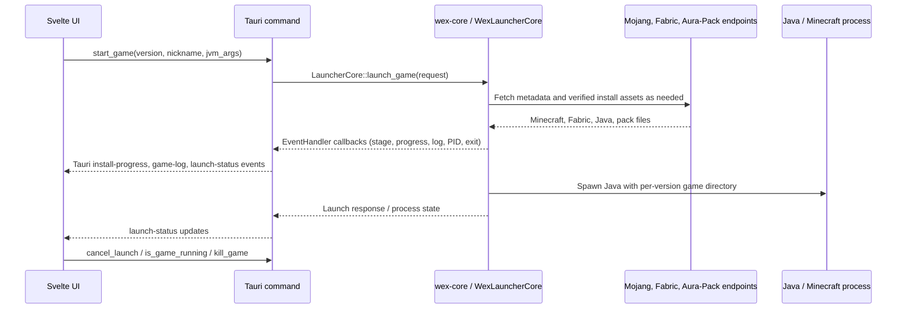

# Architecture and event flow

This document describes the code currently present in the repository. The two Rust workspaces are separate: the launcher libraries and CLI are under `core/`, while the Tauri shell is the root workspace member at `app/src-tauri`.

## Rust crates

| Module | Responsibility and main boundary |
| --- | --- |
| `core/wex-core` | Launcher primitives: `WexPaths` and config; Minecraft version metadata, client/libraries/assets; Fabric profile/libraries; Mojang Java runtime; hash verification and resumable/concurrent downloads; Aura-Pack manifest/settings sync; argument/classpath construction; child process launch and lifecycle; core `Event` / `EventHandler`; `WexLauncherCore` implementation of `wex-ipc::LauncherCore`. |
| `core/wex-net` | Network and game-server features isolated from the launch pipeline: server list ping with address resolution, NBT `servers.dat` read/merge/write, Lobby API client and heartbeat, mod-manifest comparison, and playit binary verification/supervision. `NetEventBus` reports tunnel and network status. |
| `core/wex-extras` | Supporting features: crash log analysis, Discord RPC activity, explicit old-launcher data import, skin format/validation helpers, and graphics preset application. |
| `core/wex-social` | Friend/API models, local achievement progress, workshop helpers for worlds/backups/screenshots, bundled release notes, and launcher update manifest checks. |
| `core/wex-ipc` | Shared serde command/model/error/event DTOs, `LauncherCore` async trait and mock, plus Rust-to-TypeScript binding generation. |
| `core/wex-cli` | Clap CLI for pack sync, full install, and launching a version through `wex-core`. |
| `app/src-tauri` | Tauri setup, managed `PlayState`, command handlers, Discord and crash-diagnosis integration, and bridging launch events to Tauri window events. |

The app currently wires the play/config commands through the `wex-ipc::LauncherCore` trait and `wex-core::WexLauncherCore`. `wex-ipc` contains broader command contracts and generated UI types; this does not mean every social, network, workshop, or extras command is currently exposed by the Tauri command registry.

## App startup

`app/src-tauri/src/lib.rs::run` creates the default `WexPaths`, ensures the Wex data directories, constructs `PlayState::new_real`, and registers it with Tauri. It registers config, installed-version, launch/cancel, running-state and kill commands, plus compatibility aliases for the existing UI call names. `PlayState` owns the core trait object, Wex paths, launch/running flags, current version, and optional Discord RPC client.

## Launch and event flow

In code, `start_game` rejects duplicate starts, updates Discord activity, creates a cancellation-aware `LauncherCore` request, and moves preparation/launch work off the UI event loop. The core's `EventHandler` implementation is `TauriEventHandler`: it maps stage/progress to `install-progress`, game output/logs to `game-log`, and process transitions to `launch-status`. The UI in `ui/src/App.svelte` invokes the `launch_game` compatibility command and subscribes to `install-progress` and `launch-status`; the shared IPC definitions live in `core/wex-ipc` and `ui/src/lib/ipc/generated/`.

On completion, the Tauri supervisor checks the core's running state, clears the shared launch state, restores Discord activity, analyzes the instance logs with `wex-extras`, and emits the resulting status. Cancellation is represented by a core cancellation token and the `cancel_launch` command.

## Other event paths

- `wex-core::Event` is the install/process callback stream. It has console, no-op, and channel handlers, and the Tauri app adapts it to frontend events.
- `wex-net::NetEventBus` is a separate broadcast channel for network and tunnel status. It is not shown as registered in the current Tauri command/event setup.
- `wex-ipc` provides serializable IPC models, commands and event types and generates matching TypeScript modules. The app's current Tauri registry is narrower than the full feature crates.

## Data ownership

`WexPaths` selects `%APPDATA%\Wex` on Windows by default, then creates separate `instances`, `libraries`, `assets`, `versions`, `runtime`, and `logs` directories plus `config.json`. Each Minecraft version has its own instance directory, mods/config/logs, and natives. The explicit import helper reads a caller-selected old Aura Launcher directory; the normal path model points to Wex's own root.
