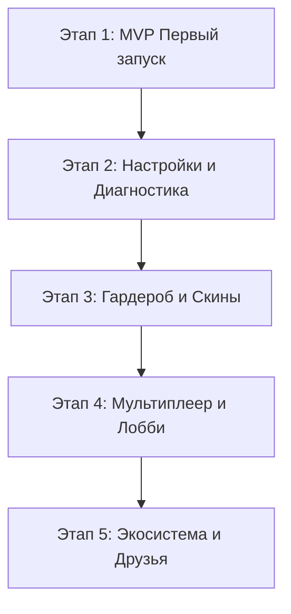

# Спецификация лаунчера Wex (v1.0)

> Документ является эталонной спецификацией для разработки нового легковесного лаунчера **Wex** (стек: Tauri 2 + Rust-ядро `core/` + Svelte 5/TypeScript `ui/`).
> Wex полностью заменяет устаревший C#/WPF Aura-Launcher. Никакой код из старого проекта не переносится напрямую — старый лаунчер используется исключительно как справочник поведения и сетевых протоколов.

---

## 1. Пользовательский интерфейс и экраны лаунчера

Интерфейс Wex строится по стандартам **Apple Human Interface Guidelines (HIG)** и концепции **Liquid Glass**:
- **Цветовая палитра**: Системные цвета Apple (`systemBlue` `#0A84FF` как главный акцент действия, `systemGreen` `#30D158` для активных переключателей, `systemRed` `#FF453A` для деструктивных действий, `systemFill` / `secondarySystemFill` для нейтральных контролов).
- **Выделение и выбор**: Только заливка (`fill`), никаких цветных неоновых рамок, обводок или свечений вокруг активных элементов.
- **Материалы**: Эффект тонкого матового стекла (`ultraThinMaterial` / `thinMaterial`), адаптация под Dark / Light / Auto режимы.
- **Доступность**: Полное уважение системных флагов *Reduce Motion* (отключение пружинных и параллакс-анимаций) и *Reduce Transparency* (переход на матовые непрозрачные подложки).

```
+----------------------------------------------------------------------------------------------------+
|  [Wex Logo]  Aura Client        (1.20.1 | 1.21.1)               [PlayerNick] [Avatar] [_] [x]     |
+----------------------------------------------------------------------------------------------------+
|  [SIDEBAR]       |  [MAIN CONTENT AREA]                                                           |
|                  |                                                                                |
|  * Обзор         |  +--------------------------------------------------------------------------+  |
|  * Лобби         |  | Карточка сборки: Aura Pack (v20261030)                                    |  |
|  * Друзья        |  | Статус: Установлено • 142 мода • Обновлено сегодня                        |  |
|  * Гардероб      |  +--------------------------------------------------------------------------+  |
|  * Мастерская    |                                                                                |
|  * Настройки     |  [Новости и обновления]                     [Недавние снимки экрана]          |
|                  |  • Релиз сборки 1.21.1                      [Img1] [Img2] [Img3]               |
|                  |  • Исправления шейдеров                                                        |
+------------------+--------------------------------------------------------------------------------+
|  [Загрузка: ========================= 100%] [ Скорость: 14 МБ/с ]    [  ИГРАТЬ (systemBlue)  ]    |
+----------------------------------------------------------------------------------------------------+
```

### 1.1. Экран начальной загрузки (Startup Splash)
- **Что видит пользователь**:
  - Центрированное компактное окно без системных рамок с мягким размытием фона.
  - Логотип Aura/Wex, текущая версия лаунчера (`v1.0.0`), индикатор статуса с мягкой индикацией («Проверка обновлений…», «Загрузка обновления…»).
  - При наличии обновления лаунчера: аккуратная полоса загрузки с процентами и скоростью.
  - При ошибке сети: кнопки «Повторить» и «Пропустить» (для перехода в офлайн-режим).
- **Что происходит под капотом**:
  - Инициализация `wex-core`: чтение конфигурации из `%APPDATA%\Wex\config.json`.
  - Запуск фоновой проверки обновлений лаунчера через `tauri-plugin-updater`.
  - Проверка целостности базовых каталогов инстансов.
  - Мягкий переход (cross-fade 250 мс) в главное окно приложения.

### 1.2. Главное окно (Application Shell)
- **Что видит пользователь**:
  - Единая оболочка с боковой панелью навигации (Sidebar) слева:
    - **Обзор** (Overview) — домашний экран запуска игры.
    - **Лобби** (Lobby) — мультиплеер, облачные комнаты, LAN и Playit-туннели.
    - **Друзья** (Friends) — список друзей, статусы присутствия, инвайты, достижения.
    - **Гардероб** (Wardrobe) — скины, плащи, интерактивная 3D-модель персонажа.
    - **Мастерская** (Workshop) — миры, моды, ресурс-паки, шейдеры, скриншоты.
    - **Настройки** (Settings) — параметры Java, память, папки, пресеты графики.
  - Вверху справа: плашка профиля (аватар игрока, никнейм, индикатор сети) и кнопки управления окном.
  - Внизу (Bottom Bar): постоянный блок состояния запуска:
    - Селектор версии игры (`1.20.1` / `1.21.1`).
    - Статусная строка («Готов к игре», «Синхронизация модов 45/140…», «Запуск Minecraft…»).
    - Полоса прогресса скачивания (скрыта в покое).
    - Главная кнопка **«ИГРАТЬ»** (`systemBlue`, при запущенной игре превращается в нейтральную кнопку «В игре» / «Остановить»).

### 1.3. Экран «Обзор» (Overview)
- **Что видит пользователь**:
  - Карточка сборки Aura: название сборки, версия ядра (Minecraft + Fabric Loader), количество установленных модов, дата последнего обновления сборки.
  - Блок статистики игрока: суммарное игровое время («XX ч. YY мин.»), общее количество запусков, блок последнего полученного достижения.
  - Лента новостей и список изменений (Changelog): список последних версий сборки и клиента с группировкой изменений по тегам (`[Новое]`, `[Улучшено]`, `[Исправлено]`).
  - Галерея недавних скриншотов: миниатюры последних снимков экрана из папки `screenshots/` выбранной версии.
- **Что происходит под капотом**:
  - При нажатии «ИГРАТЬ»:
    1. Проверка никнейма (3–16 символов, `[A-Za-z0-9_]`).
    2. Проверка и фоновая загрузка манифеста Aura-Pack (`manifest.json` или `manifest-1.21.1.json`).
    3. Скачивание отсутствующих или изменившихся файлов сборки в параллельном пуле (до 6 потоков).
    4. Проверка и докачка компонентов Minecraft (клиент, библиотеки, ассеты, JRE 17/21).
    5. Формирование Java-аргументов и запуск процесса через `@argsFile`.
    6. Старт таймера игровой сессии и переключение статуса Discord RPC в «В игре».

### 1.4. Экран «Лобби» (Lobby & P2P Multiplayer)
- **Что видит пользователь**:
  - Переключатель режимов: **«LAN & Туннели»** и **«Облачные миры»**.
  - **Для хоста**:
    - Выбор локального одиночного мира из списка доступных сохранений.
    - Кнопка «Открыть мир для друзей».
    - После открытия: генерация 4-значного кода комнаты (например, `#A7X9`), отображение статуса туннеля (Playit public IP:Port), список подключившихся игроков.
  - **Для гостя**:
    - Поле ввода кода лобби, кнопка «Подключиться».
    - Карточка комнаты: имя хоста, пинг, список игроков на виртуальной сцене.
    - Статус синхронизации модов (зеленый значок «Моды совпадают» или оранжевый «Расхождений: N»).
    - Кнопка «Исправить и войти» (автоматически включает/выключает несовпадающие моды).
- **Что происходит под капотом**:
  - Обмен данными с `lobby-api` по REST/WebSocket.
  - Хост поднимает локальный LAN-сервер Minecraft, `LanWorldWatcher` перехватывает порт, запускается `playit-agent` для проброса порта наружу.
  - Публичный адрес передается в лобби-сервис.
  - Гость получает адрес туннеля и автоматически подключается с аргументом `--quickPlayMultiplayer <host:port>`.

### 1.5. Экран «Друзья» (Friends & Social)
- **Что видит пользователь**:
  - Мой Friend Code (например, `AUR-7821-X9`) с кнопкой копирования в буфер.
  - Поле добавления друга по коду.
  - Входящие заявки в друзья (с кнопками «Принять» / «Отклонить»).
  - Список друзей с разделением: «В сети», «В игре», «В лобби», «Не в сети».
  - При нахождении друга в лобби — кнопка «Войти» или всплывающий тост инвайта («[Игрок] приглашает вас в лобби»).
  - Карточка профиля друга: аватар, 3D-скин, общее время игры, разблокированные достижения.
- **Что происходит под капотом**:
  - При старте лаунчер регистрирует пользователя на сервере через `api/user/register` (токен сохраняется в защищенном хранилище).
  - Фоновый поллинг `api/sync` каждые 15–30 секунд передает текущий статус и забирает обновления друзей и инвайты.

### 1.6. Экран «Гардероб» (Wardrobe)
- **Что видит пользователь**:
  - Интерактивный 3D-просмотр персонажа с поддержкой вращения мышью (yaw/pitch) и зума.
  - Переключатель типа модели: **Classic (Steve 4px)** / **Slim (Alex 3px)**.
  - Кнопка «Загрузить скин (PNG)» и «Сбросить на стандартный».
  - Выбор официальных плащей Aura: `Cyan`, `Silver`, `Пользовательский`, `Без плаща`.
  - История ранее использованных скинов и плащей (миниатюры для быстрой смены).
- **Что происходит под капотом**:
  - Валидация PNG-файла (строго 64×64 или 64×32, размер ≤ 2 МБ).
  - Определение Slim/Classic по прозрачности пикселей плечевого шва `(54, 20)`.
  - Сохранение скина в профиле `%APPDATA%\Wex\skins\<sha256>.png`.
  - Экспорт скина в `CustomSkinLoader`: `<instanceDir>\CustomSkinLoader\LocalSkin\skins\<PlayerNick>.png`.
  - Очистка кэша CustomSkinLoader для немедленного отображения в игре.

### 1.7. Экран «Мастерская» (Workshop)
- **Что видит пользователь**:
  - Вкладка **«Миры»**: список одиночных сохранений с миниатюрами, сидом, режимом игры, днем мира и координатами игрока. Кнопки «Сделать бэкап», «Восстановить», «Играть».
  - Вкладка **«Моды»**: список всех `.jar` файлов в инстансе с поиском. Тумблер включения/выключения для каждого мода (`.jar` ↔ `.jar.disabled`).
  - Вкладка **«Шейдеры»**: список шейдер-паков, переключение активного шейдера без запуска игры.
  - Вкладка **«Скриншоты»**: полноэкранная галерея скриншотов с возможностью открыть в проводнике или удалить.
- **Что происходит под капотом**:
  - Парсинг `level.dat` через чистый NBT-парсер (быстрое чтение тегов `Data.LevelName`, `DayTime`, `Player.Pos`).
  - Чтение метаданных `fabric.mod.json` внутри `.jar` архивов для получения названия, автора и иконки мода.

### 1.8. Экран «Настройки» (Settings)
- **Что видит пользователь**:
  - **Игра**: Игровой никнейм (с валидацией в реальном времени), выбор объема ОЗУ (пресеты 4 ГБ, 6 ГБ, 8 ГБ, 12 ГБ + ползунок с шагом 512 МБ), выбор графического пресета (Low / Medium / High / Ultra / Custom).
  - **Система**: Путь к папке данных игры, путь к исполняемому файлу Java (автоопределение или ручной выбор), дополнительные флаги JVM.
  - **Лаунчер**: Тема оформления (Dark / Light / Auto), автозапуск, Discord RPC, автообновления, громкость фоновой музыки.
  - **Диагностика**: Кнопка «Проверить целостность файлов» (полная сверка всех хэшей по SHA-256), «Открыть папку с логами», «Сброс настроек».

---

## 2. Внешние сервисы, протоколы и сетевой стек

### 2.1. Загрузка и синхронизация сборки (Aura-Pack)
- **Источник**: `https://raw.githubusercontent.com/{owner}/{repo}/{branch}/`
  - По умолчанию: `qutlawsoasis-debug/Aura-Pack`, ветка `main`.
- **Манифесты**:
  - Для Minecraft 1.20.1: `manifest.json` (в корне репозитория).
  - Для Minecraft 1.21.1: `manifest-1.21.1.json` (в корне) или префикс `versions/1.21.1/`.
- **Формат манифеста (`manifest.json`)**:
```json
{
  "name": "Aura",
  "packVersion": "20261030.1613",
  "minecraft": "1.20.1",
  "fabricLoader": "0.19.5",
  "files": [
    {
      "path": "mods/sodium-fabric-0.5.11+mc1.20.1.jar",
      "sha256": "4b68e...",
      "size": 1284560,
      "mode": "sync"
    },
    {
      "path": "config/appleskin.json5",
      "sha256": "ae87f...",
      "size": 1327,
      "mode": "default"
    }
  ],
  "servers": [
    {
      "name": "Aura Official",
      "ip": "play.auraclient.ru:25565"
    }
  ]
}
```
- **Правила режимов `mode`**:
  - `sync`: Файл сборки строго контролируется. Если локальный файл отсутствует, имеет другой размер или при полной проверке не совпадает SHA-256 — он перезаписывается. Если файл имеет суффикс `.disabled`, проверяется также базовое имя без `.disabled`.
  - `default`: Начальная конфигурация. Скачивается только один раз при первичной установке. Если пользователь изменил файл — лаунчер его НЕ перезаписывает при очередных апдейтах.
- **Правила `pack.settings.json` и `forceConfigs`**:
```json
{
  "name": "Aura",
  "minecraft": "1.20.1",
  "fabricLoader": "0.19.5",
  "forceConfigs": [
    "tlm_custom_pack/Aura_Maid.zip",
    "config/touhou_little_maid-common.toml",
    "config/litematica.json"
  ]
}
```
  - Если путь к файлу содержится в массиве `forceConfigs`, он принудительно синхронизируется в режиме `sync`, даже если в основном манифесте для него стоял `default`.
- **Пул шейдеров (`shaderpacks_pool`)**:
  - В репозитории пака тяжелые шейдеры лежат в `shaderpacks_pool/<Name>.zip`.
  - Они не скачиваются все разом в инстанс игры, а загружаются по требованию выбранного графического пресета (Low / Medium / High / Ultra).
  - Кэшируются в центральном хранилище `%APPDATA%\Wex\shaderpacks_pool\` и копируются/линкуются в `<instanceDir>\shaderpacks\`.

### 2.2. Установка и запуск Minecraft, Fabric и Java

```
+----------------------------------------------------------------------------------------------------+
| 1. MOJANG VERSION MANIFEST                                                                         |
|    GET https://piston-meta.mojang.com/mc/game/version_manifest_v2.json                             |
|    -> Находим 1.20.1 / 1.21.1 -> скачиваем <version>.json -> client.jar, libraries, assetIndex    |
+----------------------------------------------------------------------------------------------------+
                                                  |
+----------------------------------------------------------------------------------------------------+
| 2. FABRIC LOADER META                                                                              |
|    GET https://meta.fabricmc.net/v2/versions/loader/{game_version}/{loader_version}/profile/json   |
|    -> Скачиваем KnotClient библиотеки, зависимости org.ow2.asm, fabric-loader.jar                  |
+----------------------------------------------------------------------------------------------------+
                                                  |
+----------------------------------------------------------------------------------------------------+
| 3. ASSETS & JRE RUNTIME                                                                            |
|    Mojang Assets: https://resources.download.minecraft.net/{hash[0..2]}/{hash}                    |
|    JRE Runtime: 1.20.1 -> java-runtime-gamma (Java 17) | 1.21.1 -> java-runtime-delta (Java 21)   |
+----------------------------------------------------------------------------------------------------+
                                                  |
+----------------------------------------------------------------------------------------------------+
| 4. СБОРКА АРГУМЕНТОВ И ЗАПУСК                                                                      |
|    Формирование @argsFile (UTF-8, экранирование путей) -> javaw.exe @argsFile                      |
+----------------------------------------------------------------------------------------------------+
```

- **Mojang Manifest API**:
  - Версионный манифест: `https://piston-meta.mojang.com/mc/game/version_manifest_v2.json`.
  - Скачивание `client.jar` с проверкой SHA-1.
  - Скачивание ассетов: индекс ассетов `indexes/<id>.json`, сами объекты из `https://resources.download.minecraft.net/<hash[0..2]>/<hash>`.
  - Извлечение нативных библиотек (`natives`) в выделенную подпапку инстанса `natives/`.
- **Fabric Meta API**:
  - Профиль загрузчика: `https://meta.fabricmc.net/v2/versions/loader/{game_version}/{loader_version}/profile/json`.
  - Объединение списка библиотек Mojang и Fabric без дубликатов.
  - Главный класс: `net.fabricmc.loader.impl.launch.knot.KnotClient`.
- **Java Runtime Environment**:
  - 1.20.1 требует **Java 17** (`java-runtime-gamma`).
  - 1.21.1 требует **Java 21** (`java-runtime-delta`).
  - Порядок поиска JRE в Wex:
    1. Изолированная среда в `%APPDATA%\Wex\runtime\windows-x64\<component>\bin\javaw.exe`.
    2. Путь, указанный пользователем вручную в настройках.
    3. Системные JDK (`JAVA_HOME`, Eclipse Adoptium, Microsoft OpenJDK, Oracle Java).
    4. Если ни один не найден — автоматическое скачивание официального Mojang JRE пакета через манифест версий.
- **Запуск через `@argsFile`**:
  - На Windows лимит длины командной строки равен 32 767 символов. При 150+ модах Classpath превышает этот лимит.
  - Аргументы JVM и игры записываются в файл `<instanceDir>\launcher-args.txt` в кодировке UTF-8, запуск производится: `javaw.exe @launcher-args.txt`.
  - Обязательные аргументы:
    `-Xmx{RamMb}M`, `-Xms1024M`, `-Djava.library.path={nativesDir}`, `-cp "{classPath}"`,
    `net.fabricmc.loader.impl.launch.knot.KnotClient`,
    `--username {Nickname}`, `--version {Version}`, `--gameDir "{instanceDir}"`, `--assetsDir "{assetsDir}"`, `--assetIndex {assetIndex}`, `--uuid {OfflineUuid}`, `--accessToken 0`, `--userType legacy`.

### 2.3. Лобби API (Lobby API Client)
- **Базовый URL**: `https://lobby-api.vercel.app` (настраивается в `lobbyApiBaseUrl`).
- **Спецификация эндпоинтов**:
  1. `POST /api/lobby`
     - Request: `{ "hostName": string, "manifest": [ModManifestEntry]? }`
     - Response: `{ "code": string, "hostToken": string, "status": "open", "createdAt": number }`
  2. `POST /api/lobby/join`
     - Request: `{ "code": string, "playerName": string, "manifest": [ModManifestEntry]? }`
     - Response: `{ "success": bool, "code": string, "status": string, "tunnelAddress": string?, "playerCount": number }`
  3. `POST /api/lobby/open`
     - Request: `{ "code": string, "hostToken": string, "tunnelAddress": string, "port": number }`
     - Response: `{ "success": bool }`
  4. `GET /api/lobby/status?code={code}&player={nick}`
     - Response:
       ```json
       {
         "code": "A7X9",
         "status": "open",
         "tunnelAddress": "pgsql-jill.tun.ply.gg:38062",
         "playerCount": 2,
         "lastHeartbeat": 1731000000,
         "players": ["HostPlayer", "GuestPlayer"],
         "hostName": "HostPlayer",
         "modSync": {
           "GuestPlayer": {
             "hash": "4a7b21f9c0e3",
             "status": "synced",
             "mismatches": []
           }
         },
         "kicked": false
       }
       ```
  5. `POST /api/lobby/heartbeat` — отправка пульса каждые 15 сек (`{ "code": string, "hostToken": string }`).
  6. `POST /api/lobby/close` — закрытие комнаты хостом.
  7. `POST /api/lobby/leave` — выход игрока.
  8. `POST /api/lobby/kick` — изгнание игрока хостом (`{ "code": string, "hostToken": string, "player": string }`).
  9. `GET /api/tunnel-config` (Заголовок: `X-Aura-Client: launcher`)
     - Response: `{ "secret": string, "publicAddress": string, "publicPort": number }`

### 2.4. Playit-туннели (P2P Connectivity)
- **Бинарный агент**: `playit-windows-x86_64-signed.exe` (версия 0.15.26).
- **URL загрузки**: `https://github.com/playit-cloud/playit-agent/releases/download/v0.15.26/playit-windows-x86_64-signed.exe`.
- **SHA-256**: `dd1acb19e47bca4a935f2f72a68390bd2fc3a8ed608af7c9c247d3a69d7fba0a`.
- **Хранение секретов**: Файл `%APPDATA%\Wex\tools\playit.secret`.
- **Управление процессом в Rust**:
  - Запуск через `std::process::Command` с флагом создания Job Object на Windows (при завершении Wex процесс агента туннеля гарантированно уничтожается операционной системой, исключая зомби-процессы).

### 2.5. Discord Rich Presence (RPC)
- **Application ID**: `1556968494673690674`
- **Ассеты**:
  - `LargeImageKey`: `aura_logo` (подпись: «Aura Client»).
  - `SmallImageKey`: `minecraft` («Minecraft 1.20.1» / «1.21.1») или `online` («P2P Multiplayer»).
- **Состояния**:
  - В лаунчере: `Details`: «В главном меню», `State`: «Выбирает режим игры».
  - В лобби: `Details`: «В лобби #{Code}», `State`: «Игроков: N/8 • Хост: {HostName}».
  - В одиночной игре: `Details`: «В мире: {WorldName}», `State`: «Сборка Aura Pack • Модов: {Count}», `Timestamps.Start`: время старта.
- **Кнопка**: Label: «Скачать Aura Client», Url: «https://github.com/qutlawsoasis-debug/Aura-Launcher».

### 2.6. Социальные функции и друзья
- **API**:
  - `POST /api/user/register` — регистрация: `{ "nick": string }` → `{ "userId": string, "userToken": string, "friendCode": string }`.
  - `POST /api/sync` — синхронизация присутствия и получение инвайтов.
  - `POST /api/friends/request` — отправка заявки по `friendCode`.
  - `POST /api/friends/respond` — `{ "fromId": string, "accept": bool }`.
  - `POST /api/friends/remove` — `{ "friendId": string }`.
  - `POST /api/invite` — `{ "friendId": string, "lobbyCode": string, "hostToken": string }`.
  - `POST /api/invite/respond` — `{ "inviteId": string, "accept": bool }`.
  - `GET /api/user/profile?friendId={id}` — получение профиля (достижения, скины, время).

### 2.7. Система достижений лаунчера
- **Конфигурация**: `Data/achievements.json`.
- **Отслеживаемые события**:
  - `first_launch` (1 запуск) — «Искра».
  - `ten_launches` (10 запусков) — «Постоялец».
  - `hundred_hours` (100 часов в игре) — «Сто часов».
  - `marathon` (5 часов в одной непрерывной сессии) — «Марафон».
  - `night_shift` (запуск между 03:00 и 05:00) — «Ночная смена».
  - `first_lobby` (первое созданное лобби) — «Хост».
  - `full_table` (4 игрока в лобби) — «Полный стол».
  - `reconnected` (нажатие кнопки переподключения) — «Вернулся».
- **Хранение прогресса**: `%APPDATA%\Wex\achievements.json`.

### 2.8. Скин-система
- **Форматы скинов**: PNG 64×64 (современный с 1.8+) и 64×32 (legacy).
- **Определение Slim модели (Alex)**:
  - Сканирование прозрачности альфа-канала правого рукава в координатах `(54, 20)`..`(55, 31)`. Если пиксели пусты — рука имеет ширину 3px (Slim), иначе 4px (Classic).
- **Интеграция с игрой**:
  - Инъекция в `CustomSkinLoader`: лаунчер формирует файл `<instanceDir>\CustomSkinLoader\CustomSkinLoader.json` с локальным провайдером `LocalSkin`.
  - Файлы кладутся в `<instanceDir>\CustomSkinLoader\LocalSkin\skins\<PlayerNick>.png` и `capes\<PlayerNick>.png`.
  - Сброс директории кэша `<instanceDir>\CustomSkinLoader\caches` для моментального применения без перезагрузки текстур.

### 2.9. Мониторинг серверов и протокол SLP (Server List Ping)
- **Синхронизация `servers.dat`**:
  - Файл в формате несжатого Big-Endian NBT.
  - Массив `Compound` тегов в `servers`: `{ "name": string, "ip": string, "icon": string? }`.
  - Wex добавляет официальные серверы Aura, не повреждая добавленные вручную пользовательские серверы.
- **Протокол SLP (Minecraft Server List Ping)**:
  1. TCP соединение с хостом и портом (таймаут 2.5 сек).
  2. Отправка Handshake пакета (`PacketID: 0x00`, `ProtocolVersion: 763`, `Host`, `Port`, `NextState: 1`).
  3. Отправка Status Request (`PacketID: 0x00`).
  4. Получение ответа: парсинг JSON с онлайн/максимум игроков, описанием (MOTD) и base64-иконкой.
  5. Измерение времени кругового обращения (RTT ping в миллисекундах).

### 2.10. Автоматический анализ крашей (Game Crash Analyzer)
Лаунчер перехватывает завершение процесса Java с ненулевым exit-кодом и парсит логи:
1. `ExitCode: -805306369` (0xC0000005) или маркеры `OutOfMemoryError`:
   - *Диагноз*: «Нехватка оперативной памяти (ОЗУ)».
   - *Совет*: «Увеличьте выделенную память в Настройках лаунчера (рекомендуется 6–8 ГБ)».
2. Маркеры GPU (`nvoglv64.dll`, `atio6axx.dll`, `GLFW error`, `GL_OUT_OF_MEMORY`, `CompileShader`):
   - *Диагноз*: «Сбой видеодрайвера или шейдеров».
   - *Совет*: «Отключите шейдеры в Мастерской или переключите графический пресет на Низкий».
3. Маркеры Fabric/Mixin (`MixinApplyError`, `Incompatible mods found`):
   - *Диагноз*: «Конфликт модов».
   - *Совет*: «Проверьте добавленные вручную сторонние моды или обновите сборку».
4. Маркеры мира (`SessionLock`, `already locked`, `Failed to read chunk`):
   - *Диагноз*: «Повреждение файлов мира».
   - *Совет*: «Восстановите мир из резервной копии во вкладке Мастерская».

---

## 3. Структура хранения данных и стратегия изоляции

### 3.1. Каталоги старого лаунчера (Aura-Launcher)
Старый лаунчер оставлял файлы по следующим путям:
- `%APPDATA%\.aura\` — корень данных:
  - `config.json` — настройки пользователя.
  - `pack-state.json` — хэши и версия установленной сборки.
  - `instances\1.20.1\` и `instances\1.21.1\` — файлы игры.
  - `assets\`, `libraries\`, `versions\`, `runtime\` — общие компоненты Minecraft.
  - `skins\`, `capes\` — локальные текстуры.
  - `tools\` — бинарник playit.
- `%LOCALAPPDATA%\AuraLauncher\` — файлы установки WPF-клиента (Velopack).

### 3.2. Каталог нового лаунчера Wex (Полная изоляция)
Согласно **Правилу 3 AGENTS.md**, Wex никогда не изменяет и не затирает файлы старого лаунчера. Все данные хранятся в собственном корне:
- `%APPDATA%\Wex\` (настраивается переменной окружения `WEX_DATA_DIR`):
  - `config.json` — конфигурация Wex.
  - `accounts.json` — профили игроков.
  - `achievements.json` — прогресс достижений.
  - `shared\`:
    - `assets\` — ассеты Minecraft (пул объектов по SHA-1).
    - `libraries\` — общие библиотеки Java/Minecraft/Fabric.
    - `runtimes\` — установленные JRE (Java 17, Java 21).
    - `shaderpacks_pool\` — централизованный кэш шейдеров.
  - `instances\`:
    - `1.20.1\` — изолированный инстанс 1.20.1 (`mods/`, `config/`, `saves/`, `options.txt`).
    - `1.21.1\` — изолированный инстанс 1.21.1.
  - `tools\` — утилиты (`playit-agent.exe`).
  - `logs\` — логи лаунчера и запусков игры.

### 3.3. Функция безопасного импорта (Migration / Import)
При первом запуске, если Wex обнаруживает `%APPDATA%\.aura`, пользователю ненавязчиво предлагается модальное окно:
*«Найдена предыдущая установка Aura. Перенести ваши сохранения, скриншоты и настройки?»*
- **Только чтение старых каталогов**: исходные файлы `%APPDATA%\.aura` остаются абсолютно нетронутыми.
- **Импортируемые данные**:
  1. Никнейм игрока и назначенный объем ОЗУ.
  2. Папки сохранений одиночных миров (`saves/` → копирование в соответствующий инстанс Wex).
  3. Скриншоты (`screenshots/`).
  4. Файлы скинов и плащей из `skins/` и `capes/`.
  5. Переиспользование скачанных ванильных ассетов и библиотек (проверка SHA-1 перед копированием или созданием жестких ссылок NTFS, что экономит до 5 ГБ дискового пространства и интернет-трафика).

---

## 4. Архитектурный анализ старого кода: проблемы и решения в Wex

| Компонент / Проблема в старом лаунчере | Почему это было плохо (Каша/Баги) | Как сделано правильно в Wex |
| :--- | :--- | :--- |
| **WPF и C# ViewModels («Божественные классы»)** | `LobbyViewModel.cs` (148 КБ), `FabricGameLaunchService.cs` (89 КБ), `SceneDiagnostics.cs` (159 КБ). Логика UI, сети, P/Invoke и файлов перемешана в одном файле. | Разделение на слои: чистое Rust-ядро `wex-core` (без UI) + типизированный IPC-мост Tauri 2 + легковесный Svelte 5 фронтенд. |
| **Блокировки UI-потока** | Вызовы `.GetAwaiter().GetResult()` в синхронных геттерах или событиях WPF, приводящие к фризам интерфейса при медленном диске или сети. | Полностью асинхронный Tokio рантайм в Rust. Все I/O и сетевые операции выполняются в фоновых пулах. UI никогда не блокируется. |
| **Проглатывание исключений (`catch { }`)** | Сотни пустых блоков `catch { }` по всему коду маскировали реальные причины падений, не давая пользователю информации об ошибке. | Строгая типизация ошибок через перечисления `thiserror` в Rust. Каждая ошибка содержит контекст и транслируется в понятное сообщение для UI. |
| **Командная строка Windows (`CommandLine`)** | Сборка строки запуска Minecraft через склейку строк. При длинном Classpath запуск падал с ошибкой «The command line is too long». | Генерация стандартного Java Argument File (`@argsFile`) в формате UTF-8 с корректным экранированием путей и параметров. |
| **Утечки фоновых процессов** | При аварийном закрытии лаунчера `playit.exe` или фоновый Minecraft оставались висеть в памяти, блокируя порты. | Регистрация дочерних процессов в Windows Job Object с флагом `JOB_OBJECT_LIMIT_KILL_ON_JOB_CLOSE`. При закрытии Wex ОС принудительно гасит дочерние процессы. |
| **Синхронизация пака и CDN кэш** | Зависимость от CDN `raw.githubusercontent.com`. При устаревании кэша лаунчер мог откатить версию или циклически перекачивать файлы. | Проверка заголовков ETag, сравнение версий по семантическому номеру даты-времени, валидация хэшей перед заменой, скачивание во временные `.part` файлы с атомарным переименованием. |
| **Отсутствие кроссплатформенности** | Жесткая завязка на P/Invoke Win32 API (`dwmapi`, `kernel32`, `user32`), исключающая сборку под Linux и macOS. | Rust-абстракции: кроссплатформенные пути, абстрагирование ОС-специфичных функций (Job Object только под `#[cfg(windows)]`), поддержка Linux/macOS из коробки. |

---

## 5. План реализации и задачи для агентов

Разработка разбита на 5 последовательных этапов. Главный приоритет — **быстрый первый запуск игры (MVP)**.



### Этап 1: MVP — Первый запуск игры (1.20.1 и 1.21.1)
*Цель: Пользователь открывает лаунчер, нажимает «Играть», происходит автоматическая установка всех компонентов и старт игры.*
- **Задачи для Core (Rust)**:
  - `core/config`: Базовая структура `LauncherConfig`, сохранение и загрузка JSON из `%APPDATA%\Wex\config.json`.
  - `core/install`: Загрузчик манифеста Mojang (`version_manifest_v2.json`), скачивание `client.jar`, библиотек и ассетов по SHA-1.
  - `core/install`: Загрузчик Fabric Loader Meta, объединение библиотек.
  - `core/java`: Детектор системной Java и загрузка JRE 17/21 от Mojang.
  - `core/pack`: Синхронизация Aura-Pack (`manifest.json` и `manifest-1.21.1.json`) с параллельным пулом скачивания и SHA-256 валидацией.
  - `core/launch`: Генератор `@argsFile`, запуск процесса `javaw.exe`, обработка завершения процесса.
- **Задачи для Tauri / App**:
  - Экспорт команд: `get_config`, `set_config`, `start_game`, `cancel_launch`.
  - Потоковая передача событий прогресса установки (`install-progress`, `launch-status`).
- **Задачи для UI (Svelte 5)**:
  - Базовое окно по Apple HIG: заголовок, селектор версии (1.20.1 / 1.21.1), поле ввода никнейма.
  - Главная кнопка действия «ИГРАТЬ» с индикатором прогресса скачивания.

### Этап 2: Настройки, графика и диагностика крашей
*Цель: Тонкая настройка производительности и понятные отчеты при ошибках запуска.*
- **Задачи для Core (Rust)**:
  - `core/presets`: Реализация графических пресетов (Low / Medium / High / Ultra / Custom), модификация `options.txt`, распаковка шейдеров из `shaderpacks_pool`.
  - `core/crash`: Парсер логов `GameCrashAnalyzer`, анализ кодов выхода, извлечение трейсов `crash-reports/` и `latest.log`.
  - `core/integrity`: Потоковая проверка целостности всех установленных файлов по манифесту.
- **Задачи для UI (Svelte 5)**:
  - Экран «Настройки»: ползунок ОЗУ с шагом 512 МБ, выбор пресета графики, выбор папки игры, кнопка проверки целостности.
  - Модальное окно краша с диагнозом и понятным советом игроку.

### Этап 3: Гардероб и кастомизация (Скины и плащи)
*Цель: Управление внешним видом персонажа.*
- **Задачи для Core (Rust)**:
  - `core/skins`: Валидация PNG скинов (64×64, 64×32), автоопределение типа модели (Slim/Classic).
  - `core/skins`: Генерация конфигурации и локальных файлов для мода `CustomSkinLoader`.
  - `core/skins`: Хранилище истории скинов и плащей.
- **Задачи для UI (Svelte 5)**:
  - Экран «Гардероб»: интерактивный 3D-вьюпорт персонажа на WebGL/Three.js.
  - Переключатель Slim/Classic, выбор плащей Aura, список истории скинов.

### Этап 4: Мультиплеер, лобби и туннели
*Цель: Совместная игра в один клик без ручной настройки сети.*
- **Задачи для Core (Rust)**:
  - `core/lobby`: HTTP-клиент к `lobby-api.vercel.app` (создание, вход, статус, пульс).
  - `core/modsync`: Сравнение хэшей модов клиента и хоста, формирование списка `ModMismatchItem`.
  - `core/tunnel`: Скачивание и запуск `playit-agent`, получение публичного адреса.
  - `core/ping`: Реализация протокола Minecraft SLP (Server List Ping) для пинга серверов.
  - `core/servers`: Безопасная синхронизация `servers.dat` через Big-Endian NBT.
- **Задачи для UI (Svelte 5)**:
  - Экран «Лобби»: вкладки локальных комнат и облачных миров, ввод кода, сцена игроков с бейджами синхронизации модов.
  - Список серверов с живым пингом и онлайном.

### Этап 5: Социальные функции, экосистема и полишинг
*Цель: Полноценное сообщество, друзья и самообновление.*
- **Задачи для Core (Rust)**:
  - `core/discord`: Интеграция Discord Rich Presence (AppID `1556968494673690674`).
  - `core/friends`: Протокол синхронизации друзей, инвайты в лобби.
  - `core/achievements`: Система учета игровых достижений.
  - `core/import`: Модуль безопасного чтения старых данных из `%APPDATA%\.aura\`.
- **Задачи для UI (Svelte 5)**:
  - Экран «Друзья»: список контактов, тосты инвайтов, карточка профиля друга.
  - Экран «Мастерская»: браузер миров с резервным копированием, скриншоты.
  - Интеграция `tauri-plugin-updater` для бесшовного самообновления лаунчера.

---

## 6. Требования к верификации и контролю качества

1. **Unit-тесты в Rust (`core/`)**:
   - Парсинг манифестов Mojang и Fabric: тест на корректное построение дерева библиотек.
   - Парсинг Aura-Pack: тесты на режимы `sync`, `default`, `forceConfigs`.
   - Валидация скинов: тесты на 64×64, 64×32, некорректные размеры, определение Slim/Classic.
   - SLP Ping: тест структуры Handshake пакета и парсинга ответа.
   - NBT: чтение и запись `servers.dat` и `level.dat` без искажения данных.
2. **UI проверки (`ui/`)**:
   - `npm run check` и строгая типизация TypeScript.
   - Поддержка светлой и темной системных тем.
   - Проверка доступности: контраст текста ≥ 4.5:1 во всех состояниях, поддержка *Reduce Motion*.
3. **Изоляция окружения**:
   - Любой запуск интеграционных тестов использует изолированные временные папки, никогда не обращаясь к рабочим `%APPDATA%\.minecraft` или `%APPDATA%\.aura`.
